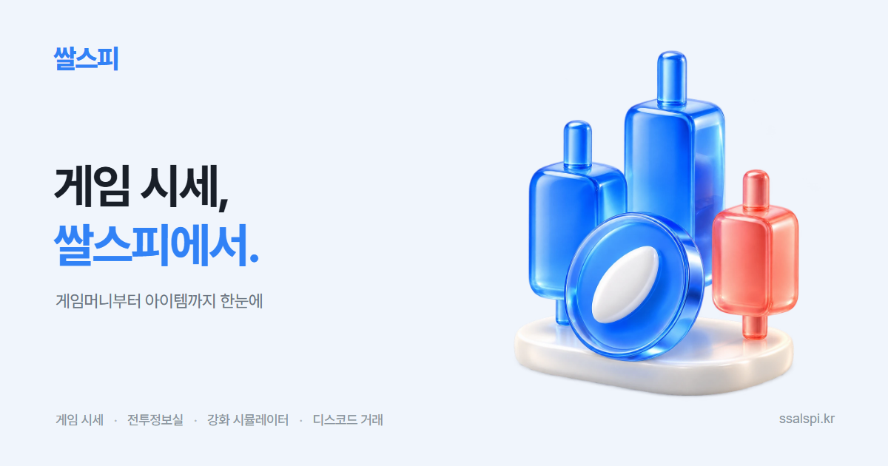
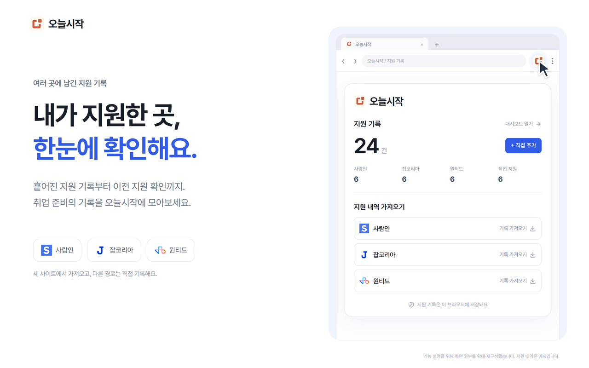

 

**Frontend developer turning everyday friction into useful products.**

사용자의 불편함에서 출발해, 직접 쓰고 싶은 제품을 만듭니다. 
트레이딩, 게임 시세, 취업 준비까지. 복잡한 정보를 다루기 쉬운 화면으로 연결합니다.

 

---

### Products

직접 만들고 다듬어가는 세 가지 제품입니다.

<table>
  <thead>
    <tr>
      <th align="center">이미지</th>
      <th align="left">이름</th>
      <th align="left">소개</th>
    </tr>
  </thead>
  <tbody>
  <tr>
    <td width="200" align="center" valign="middle">
      
    </td>
    <td width="130" valign="middle">
      <a href="https://www.orza.kr"><b>ORZA ↗</b></a> 
      orza.kr
    </td>
    <td valign="middle">
      <b>실제 시세로, 부담 없이 투자 연습.</b> 
      실시간 차트를 보며 코인 모의거래와 투자 대회에 참여하는 플랫폼입니다.
    </td>
  </tr>
  <tr>
    <td width="200" align="center" valign="middle">
      
    </td>
    <td width="130" valign="middle">
      <a href="https://www.ssalspi.kr"><b>쌀스피 ↗</b></a> 
      ssalspi.kr
    </td>
    <td valign="middle">
      <b>게임 시세를 한눈에.</b> 
      게임머니 시세와 서버별 가격을 비교하고, 캐릭터 조회와 디스코드 거래 봇을 이용하는 서비스입니다.
    </td>
  </tr>
  <tr>
    <td width="200" align="center" valign="middle">
      
    </td>
    <td width="130" valign="middle">
      <a href="https://chromewebstore.google.com/detail/dhgfnibbnjieajcmnohdkiandeljeaef"><b>오늘시작 ↗</b></a> 
      Chrome 웹 스토어
    </td>
    <td valign="middle">
      <b>내가 지원한 곳, 한곳에서 관리.</b> 
      여러 채용 사이트의 지원 기록을 모으고, 이전 지원 이력과 메모·일정을 확인하는 Chrome 확장 프로그램입니다.
    </td>
  </tr>
  </tbody>
</table>

 

---

### Tech Stack

 

`Frontend`

`Styling & UI`

`Tools & Automation`

`Blockchain & Web3`

 
 

---

### Contact

 

 
 

---

  
GitHub Activity

   
  

 

